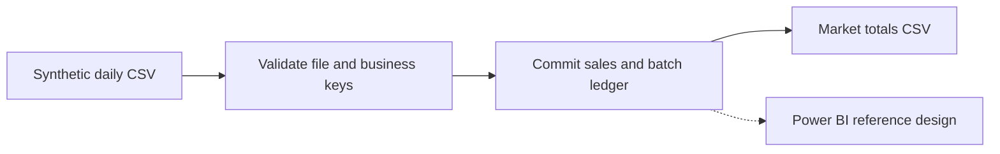

# Commercial analytics delivery portfolio

A retail reporting case study that follows daily sales from source files to validated market totals, then shows how those totals would feed a governed Power BI model. It includes a runnable Python and SQL pipeline alongside the design, testing, and release decisions that would support a wider rollout.

The case study uses fictional sales data. Run the local pipeline to verify the results below. The Power BI model and Microsoft Fabric migration are reference designs.

| Area | What to review |
| --- | --- |
| Data engineering | [Pipeline design and runbook](docs/pipeline-design.md) for the CSV contract, transactional upserts, replay protection, and rejected-batch recovery. |
| Data analytics | [Power BI semantic model design](docs/power-bi-semantic-model.md) for the fact and dimensions, 4-4-5 fiscal periods, DAX measures, and market-level access. |
| Project delivery | [Delivery playbook](docs/delivery-playbook.md) for scope, decisions, ownership, UAT, release gates, and rollback. |



## Run the demo

Run from the root of this repository with Python 3.10 or newer and SQLite 3.37 or newer. The script uses only the Python standard library. You can print the bundled SQLite version with `python -c "import sqlite3; print(sqlite3.sqlite_version)"`. Use `python3` below if your system uses that command.

```bash
python retail_pipeline.py load --db .local/retail.sqlite3 --batch-id initial --csv data/initial.csv
python retail_pipeline.py report --db .local/retail.sqlite3
python retail_pipeline.py load --db .local/retail.sqlite3 --batch-id correction --csv data/correction.csv
python retail_pipeline.py report --db .local/retail.sqlite3
```

| Market | Initial rows | Initial units | Initial sales | Corrected rows | Corrected units | Corrected sales |
| --- | ---: | ---: | ---: | ---: | ---: | ---: |
| LON | 3 | 325 | £522.50 | 4 | 350 | £560.00 |
| MAN | 3 | 245 | £395.00 | 3 | 245 | £395.00 |

The data grain is one row per sale date, market, and SKU. The correction replaces one existing value and adds one row. Sales are stored as integer pence and written to the report in GBP.

## Verify replay and rejection

Run these against the same database after the walkthrough. The first command succeeds without changing data. The last three commands each return a validation error and exit with code 1.

```bash
python retail_pipeline.py load --db .local/retail.sqlite3 --batch-id initial --csv data/initial.csv
python retail_pipeline.py load --db .local/retail.sqlite3 --batch-id initial --csv data/correction.csv
python retail_pipeline.py load --db .local/retail.sqlite3 --batch-id duplicate --csv data/invalid_duplicate.csv
python retail_pipeline.py load --db .local/retail.sqlite3 --batch-id invalid-amount --csv data/invalid_amount.csv
```

Run the report again to reconcile to the corrected totals. Using a fresh database path lets you repeat the walkthrough from an empty state.

## Trade-offs

- A repeated batch ID is accepted only when its SHA-256 matches the original file. A reviewed correction uses a new batch ID.
- Each accepted source row supplies the full daily value for its business key. The most recently accepted batch wins. Operators must submit corrections in source order because this sample feed carries no source revision number.
- A validation error rejects the entire batch. The batch runner reports the reason, and the operator reviews the original input before resubmission.
- Power BI acceptance includes reconciling model totals to the validated feed and checking market access with real Viewer identities in the service. The example DAX and security rules are documented for that implementation stage.

## Related work

- [Power BI projects](https://github.com/teruece/PowerBI_Projects)
- [Databricks notebooks and projects](https://github.com/teruece/Databricks_Codes_and_Projects)
- [SQL projects](https://github.com/teruece/SQL_Codes_and_Projects)
- [Governance and delivery toolkit](https://github.com/teruece/Governance-Framework-Documentation-Toolkit)
